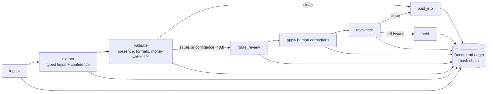

# Jagadish-document-intelligence

[](https://github.com/jagadishmazure-jpg/Jagadish-document-intelligence/actions/workflows/ci.yml)
[](https://github.com/jagadishmazure-jpg/Jagadish-document-intelligence/actions/workflows/codeql.yml)


**Intelligent document processing from paper to payment: typed extraction with per-field confidence, validation including money cross-checks, human review for anything uncertain, guarded ERP posting and tamper-evident lineage.**

> Personal learning and portfolio project. Everything runs offline on synthetic,
> fictional data with no API keys. Nothing is deployed. Numbers in this README
> come from real runs and are re-checked by CI (`scripts/render_docs.py --check`).

## Recruiter summary

- Invoices, purchase orders, contracts and receipts become validated ERP postings, with a person in the loop for every low-confidence field.
- Real run: all four clean sample documents post; a fuzzy vendor line (confidence 0.60) is held until a reviewer corrects it; a corrupted total (11,000.00 vs 11,566.80) is held with an explicit error.
- Graph-style pipeline with conditional routing and a hash-chained ledger; offline tests, CI with CodeQL and gitleaks.

## Purpose

Most finance back offices still key documents by hand. The risk in automating it
is posting a wrong number to the ledger. This repo shows the control points that
make automation safe for a fictional ingredients distributor: confidence per field,
validation that money adds up, human review for anything uncertain, a posting step
that refuses while errors remain, and lineage from source text to ERP record.

## Architecture



## How it works

| Type | Key fields |
|---|---|
| Invoice | invoice_no, vendor, date, due_date, currency, line_items, subtotal, tax, total |
| Purchase order | po_number, supplier, order_date, delivery_date, currency, line_items, subtotal, tax, total |
| Contract | agreement_no, parties, effective_date, term_months, value, currency, key_clauses |
| Expense receipt | receipt_no, merchant, date, category, amount, currency |

1. **Extract**: deterministic rules give each field a confidence (1.0 labelled
   hit, 0.7 bare pattern, 0.6 heuristic reconstruction, 0.5 partial, 0.0 missing).
2. **Validate**: required fields, date, currency and number formats, and money
   checks (line items about equal to subtotal; subtotal plus tax about equal to
   total, within 1%).
3. **Review**: fields under 0.8 confidence or with issues go to a queue that
   records why; corrections feed per-field correction stats.
4. **Post**: refused while any validation error remains; on success a
   deterministic `ERP-<doc-id>` record.
5. **Ledger**: every stage hash-chained (`verify_chain()`).

`LLMExtractor` shares the interface and refuses to run without credentials, so
the demo never pretends to call a model. Detail:
[docs/extraction-guide.md](docs/extraction-guide.md).

## Real code and output

```python
"""Paper to payment on synthetic documents: clean, low-confidence and inconsistent cases (offline)."""
from docintel import Extractor, run_document_pipeline, sample_documents
from docintel.documents import sample_invoice

print("Four synthetic document types, straight through:")
for doc in sample_documents():
    s = run_document_pipeline(doc)
    erp = s.get("erp_record") or {}
    print(f"  {doc.id:12} {doc.doc_type.value:16} outcome={s['outcome']:6} erp={erp.get('erp_ref', '-')}")

fuzzy = sample_invoice(fuzzy_vendor=True)
fields = Extractor().extract(fuzzy)
print(f"\nFuzzy vendor line: vendor={fields['vendor'].value!r} confidence={fields['vendor'].confidence:.2f}")
held = run_document_pipeline(fuzzy)
print(f"  without a reviewer correction -> {held['outcome']}")
fixed = run_document_pipeline(fuzzy, corrections={"vendor": "Acme Ingredients Co."}, reviewer="ap-clerk-2")
print(f"  with reviewer correction      -> {fixed['outcome']} ({(fixed.get('erp_record') or {}).get('erp_ref', '-')})")

bad = run_document_pipeline(sample_invoice(mismatch=True))
print(f"\nCorrupted total -> {bad['outcome']}")
for issue in bad["issues"]:
    print(f"  {issue.severity}: {issue.field}: {issue.message}")
print(f"Ledger stages: {bad['ledger'].stages_for('INV-2041')}  verifies={bad['ledger'].verify_chain()}")
```

Output of `python examples/demo.py` (real run, re-checked in CI):

<!-- run: python examples/demo.py -->
```text
Four synthetic document types, straight through:
  INV-2041     invoice          outcome=posted erp=ERP-INV-2041
  PO-CITRIC-ACID-5000 purchase_order   outcome=posted erp=ERP-PO-CITRIC-ACID-5000
  AGR-3310     contract         outcome=posted erp=ERP-AGR-3310
  RCP-88213    expense_receipt  outcome=posted erp=ERP-RCP-88213

Fuzzy vendor line: vendor='Acme Ingredients Co.' confidence=0.60
  without a reviewer correction -> held
  with reviewer correction      -> posted (ERP-INV-2041)

Corrupted total -> held
  error: total: subtotal + tax = 11,566.80 but total is 11,000.00
Ledger stages: ['ingested', 'extracted', 'validated', 'review_routed', 'reviewed', 'revalidated', 'held']  verifies=True
```
<!-- /run -->

## How to run

```bash
git clone https://github.com/jagadishmazure-jpg/Jagadish-document-intelligence.git
cd Jagadish-document-intelligence
python -m pip install pytest      # no runtime dependencies
python -m pytest -q          # offline, no keys
python examples/demo.py
python scripts/render_docs.py --check   # documented output still matches
```

Test suite size (real collection, re-checked in CI):

<!-- run: python scripts/count_tests.py -->
```text
36 tests collected
```
<!-- /run -->

## Guardrails

- Posting is refused while any validation error remains (`PostingRefused`).
- Fields under the 0.8 confidence threshold always go to a human.
- Money must reconcile within 1% before posting.
- `LLMExtractor` will not run without credentials, so nothing silently fakes a model call.
- Every stage, including held outcomes, is on a hash-chained ledger.

## Limitations

- Extraction is rule-based over text; there is no OCR or layout model in the offline build.
- Four synthetic sample documents; there is no labelled set yet for field precision and recall.
- ERP posting returns a deterministic stub record, not a call to a real ERP.
- Overlaps with Jagadish-document-automation (lifecycle, retention, e-signature); the two are kept separate for now.

## Built vs planned

| Capability | Status | Where |
|---|---|---|
| Rule-based typed extraction with confidence | Built | `docintel/extraction.py` |
| Validation with money cross-checks | Built | `docintel/validation.py` |
| Human review queue with correction stats | Built | `docintel/review.py` |
| Guarded ERP posting stub and lineage ledger | Built | `docintel/posting.py`, `docintel/lineage.py` |
| Azure AI Document Intelligence extractor | Stub (refuses without credentials) | `docintel/extraction.py::LLMExtractor` |
| Field precision/recall on 100 labelled synthetic invoices | Planned | not started |
| Real ERP posting via an integration gateway | Planned | see Jagadish-azure-ai-integration-platform |

## Implementation guide

The step-by-step path from this offline build to an Azure deployment is in
[docs/implementation-guide.md](docs/implementation-guide.md). None of it has been
run; it is a plan.

## Related repositories

| Repo | How it relates |
|---|---|
| [Jagadish-document-automation](https://github.com/jagadishmazure-jpg/Jagadish-document-automation) | Document lifecycle: repository, retention, workflow and e-signature |
| [Jagadish-azure-ai-integration-platform](https://github.com/jagadishmazure-jpg/Jagadish-azure-ai-integration-platform) | Tool and event gateways for posting into SAP and SaaS systems safely |
| [Jagadish-azure-agent-platform](https://github.com/jagadishmazure-jpg/Jagadish-azure-agent-platform) | Mortgage document intake with Azure AI Document Intelligence in a larger agent platform |
| [Jagadish-insurance-claims-agents](https://github.com/jagadishmazure-jpg/Jagadish-insurance-claims-agents) | Claims documents with the same confidence and snippet contract |

## Documentation

- [Extraction and review guide](docs/extraction-guide.md)
- [Implementation guide (Azure)](docs/implementation-guide.md)
- [Interview points](docs/interview-points.md)
- [Security policy](SECURITY.md)

## Project layout

```
docintel/
  documents.py   Document model + synthetic samples
  schemas.py     per-type field schemas
  extraction.py  rule-based Extractor + LLMExtractor stub
  validation.py  presence, format, money checks
  review.py      human review queue + correction stats
  posting.py     guarded ERP posting
  lineage.py     hash-chained DocumentLedger
  pipeline.py    graph runtime + run_document_pipeline()
examples/demo.py the run shown above
tests/           offline pytest suite
```

## License

MIT, see [LICENSE](LICENSE). All data is synthetic; every organisation and person is fictional.
